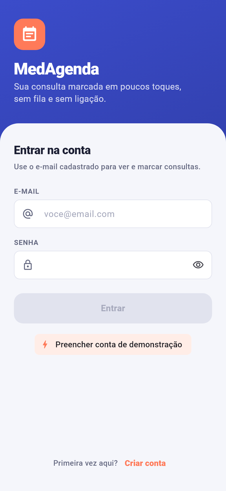
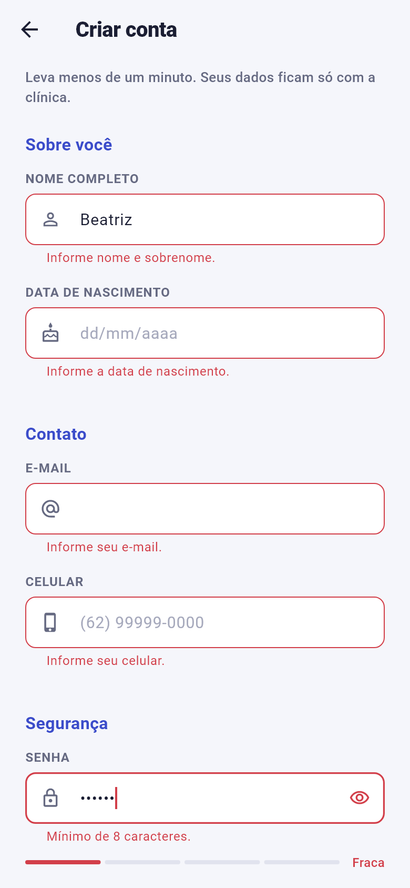
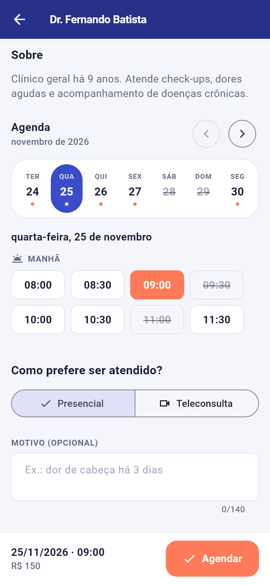
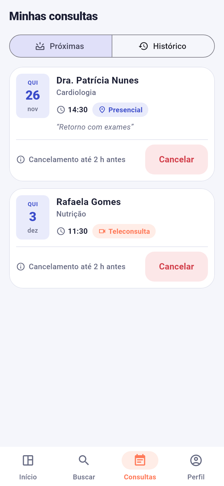
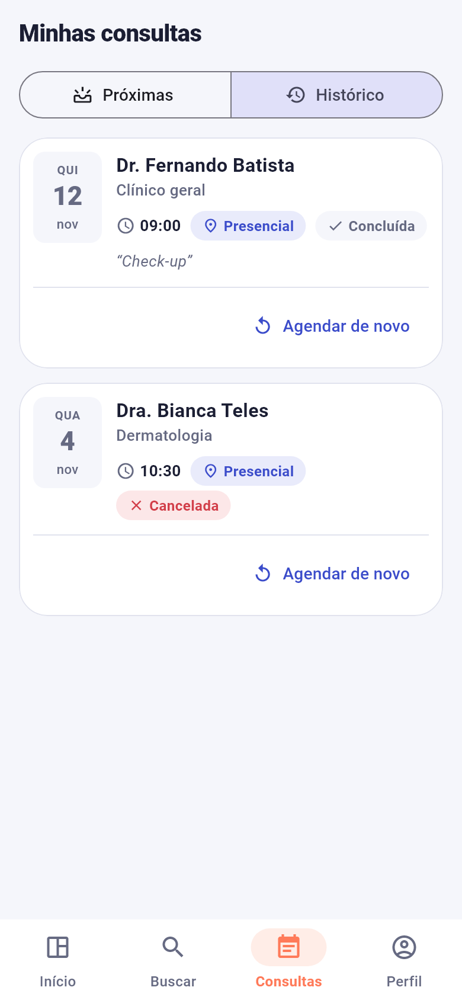
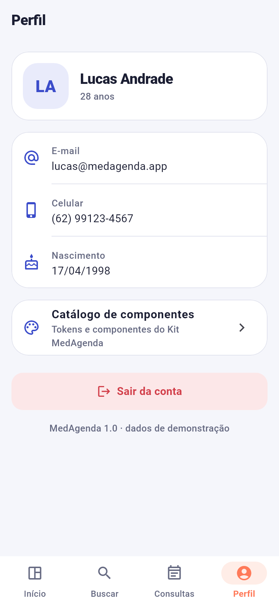
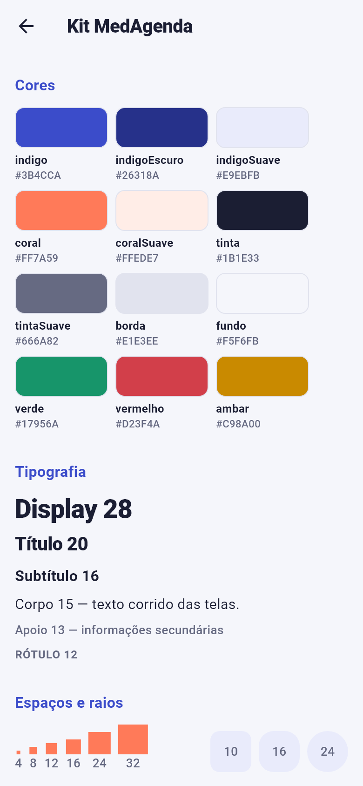

# MedAgenda

App em Flutter para **marcar consultas médicas**: o paciente cria a conta, encontra
um profissional (por nome, especialidade ou teleconsulta), escolhe dia e horário na
agenda semanal, define se quer atendimento presencial ou online e acompanha ou
cancela as consultas.

- Arquitetura **MVVM** com `ChangeNotifier` + `ListenableBuilder` (sem pacotes de terceiros)
- **Design system próprio** ("Kit MedAgenda") com catálogo navegável
- **Backend simulado** que segue o contrato em [`docs/API.md`](docs/API.md) — o app funciona sem servidor
- **33 testes** (servidor, ViewModels e fluxos completos de tela)

## Telas

| Entrar | Criar conta | Início |
|:---:|:---:|:---:|
|  |  |  |
| **Buscar** | **Profissional e agenda** | **Minhas consultas** |
|  |  |  |
| **Histórico** | **Perfil** | **Catálogo do Kit** |
|  |  |  |

## Funcionalidades

| Tela | O que faz |
|---|---|
| **Entrar** | validação dos campos, mensagem de erro da API e atalho "Preencher conta de demonstração" |
| **Criar conta** | campos agrupados, máscara de celular, data de nascimento por calendário, medidor de força da senha, erros por campo vindos da API |
| **Início** | saudação conforme a hora, próxima consulta ("Em 2 dias"), grade de especialidades e carrossel dos mais bem avaliados |
| **Buscar** | busca com espera de digitação, filtros por especialidade e teleconsulta, ordenação (nota, valor, nome) |
| **Profissional** | nota, avaliações, valor e descrição; agenda **semana a semana** com dias sem atendimento riscados, horários separados em manhã/tarde, escolha de modalidade e motivo opcional |
| **Minhas consultas** | abas *Próximas* e *Histórico*, cancelamento com confirmação (até 2 h antes) e "Agendar de novo" |
| **Perfil** | dados do paciente, acesso ao catálogo de componentes e saída da conta |

Se outro paciente ocupar o horário antes da confirmação, a API responde `409`, o app
avisa e recarrega a agenda com o horário já bloqueado.

## Arquitetura

```
 Tela (View)  ── ListenableBuilder ──▶  Controller (ViewModel, ChangeNotifier)
                                                 │
                                                 ▼
                         Repositórios: ContaRepositorio · AgendaRepositorio
                                                 │
                                                 ▼
                         ApiMedAgenda  (converte JSON ⇄ modelos, guarda o token)
                                                 │
                                                 ▼
                         Transporte (interface)
                         ├── TransporteFake → ServidorFake (memória + base.json)
                         └── TransporteHttp  (backend real — mesma interface)
```

- **Telas** só desenham e repassam eventos.
- **Controllers** guardam o estado da tela usando o tipo selado `Estado<T>`
  (`Carregando`, `Pronto`, `ComFalha`) e as regras de apresentação.
- **Repositórios**: `ContaRepositorio` mantém a sessão (o app troca entre Entrar e
  a área logada ouvindo ele); `AgendaRepositorio` avisa quando uma consulta é criada
  ou cancelada, e Início e Consultas se atualizam sozinhos.
- **Injeção de dependência** com um `InheritedWidget` (`Dependencias`), que também
  entrega o relógio — nos testes o "agora" é fixo.
- **Trocar para um servidor real**: implementar `Transporte` com HTTP e mudar uma
  linha no `main.dart`. Nada acima disso muda.

```
lib/
├── app/            MedAgendaApp, rotas e Dependencias
├── kit/            design system
│   ├── tokens/     Paleta, Espaco, Raio, Sombra, Tipo e o tema
│   └── widgets/    componentes Ma*
├── modelos/        Paciente, Sessao, Especialidade, Medico, DiaAgenda, Consulta…
├── repositorios/   ContaRepositorio e AgendaRepositorio
├── servicos/       ApiMedAgenda, Transporte e fake/ServidorFake
├── telas/          uma pasta por tela: *_page.dart (View) + *_controller.dart (ViewModel)
├── util/           datas pt-BR, validações, máscara e Estado<T>
├── main.dart
└── main_catalogo.dart   abre só o catálogo do Kit
```

## Kit MedAgenda (design system)

Paleta **índigo + coral**, cantos bem arredondados e tipografia com pesos fortes.
Tokens em `lib/kit/tokens/tokens.dart`.

| Componente | Para quê |
|---|---|
| `MaBotao` | 5 variantes (primário, destaque, contorno, fantasma, perigo) + carregando/desabilitado |
| `MaCampo` | rótulo em caixa alta, ícone, erro, mostrar/ocultar senha |
| `MaPainel` | superfície base dos cartões |
| `MaAvatar` | iniciais do nome (ignora "Dr."/"Dra.") |
| `MaEtiqueta` | pílulas de situação e modalidade |
| `MaNota` | estrela + nota + avaliações |
| `MaBlocoEspecialidade` | item da grade de especialidades |
| `MaCartaoMedico` / `MaCartaoMedicoVertical` | profissional em lista ou carrossel |
| `MaCartaoConsulta` | consulta com "folhinha" de calendário |
| `MaDiaSemana` / `MaHorario` | peças da agenda |
| `MaVazio` / `MaFalha` / `MaAlerta` / `MaCarregando` | estados de tela |
| `perguntar()` / `avisar()` | folha de confirmação e aviso rápido |

O catálogo abre pelo Perfil ou direto:

```powershell
flutter run -t lib/main_catalogo.dart
```

## Como rodar

Requer Flutter 3.32+ (Dart 3.8+).

```powershell
flutter pub get
flutter run            # Android/iOS
flutter run -d chrome  # navegador
```

**Conta de demonstração:** `lucas@medagenda.app` / `senha123` (ou toque em
"Preencher conta de demonstração").

## Testes

```powershell
flutter analyze
flutter test
```

| Arquivo | Cobre |
|---|---|
| `test/servidor_fake_test.dart` | rotas, validações, filtros, agenda, agendamento, conflitos, cancelamento e prazo de 2 h |
| `test/controllers_test.dart` | Entrar, Cadastro, Início, Buscar, Profissional (inclusive horário tomado) e Consultas |
| `test/fluxo_test.dart` | fluxos completos: login com erro → demo; busca → agendar → cancelar → histórico; catálogo |

As imagens do README são geradas por teste, com data fixa:

```powershell
flutter test capturas --update-goldens
```

## Tecnologias

Flutter · Dart 3 (sealed classes, pattern matching, records) · Material 3 ·
`flutter_localizations` (calendário em português)
